# Editing the St Paul's website

This guide is for anyone who edits the church website. Each section is one job, set out in steps, with pictures of the screens.

You edit the website in Pages CMS. It runs in your web browser on a computer, tablet or phone, and you don't need anything else.

## 1. Signing in

**The first time**

1. Look for an email from Pages CMS inviting you to the St Paul's website.
2. Click the green button in the email.

   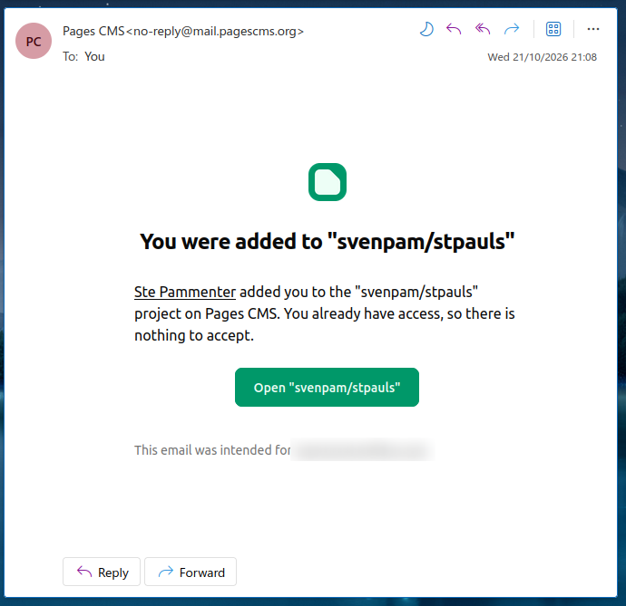
3. Pages CMS sends a second email with a 6-digit code. It only works for 5 minutes, so use it straight away.

   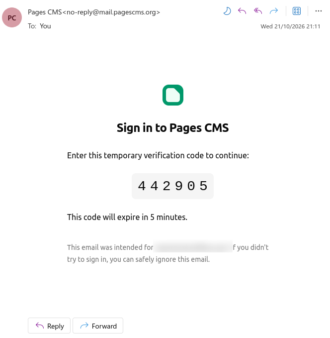

4. Type the code into the boxes and click **Verify code**.

   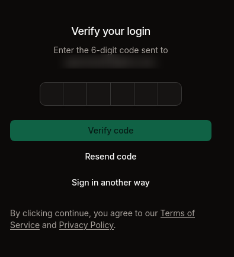
5. Pages CMS opens on the St Paul's website.

**After that**

1. Go to **app.pagescms.org**. It's worth bookmarking.
2. Ignore **Sign in with GitHub**. Type your email address in the box below it and click **Continue with email**.

   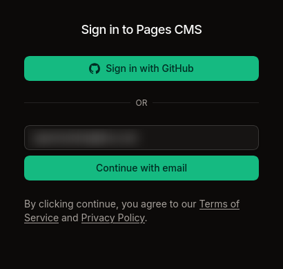
3. Pages CMS emails you a new 6-digit code. Type it in and click **Verify code**.
4. If Pages CMS asks which website, choose St Paul's.

If the code has run out, click **Resend code**. The old "log in" link on the website also brings you here.

**Finding your way around**

The list down the left-hand side is where everything lives:

| In the list | What it is |
|---|---|
| Notices | Church notices on the home page and the Notices page |
| Events | The calendar |
| Blog | Blog articles |
| Pages | Every other page, grouped as in the top menu: About, Services, Groups, Community, Links, Gallery, Forms, Safeguarding |
| Home page | The big picture and the words on it |
| Site settings | The address, Facebook link and contact form |
| Blog page, Calendar page, Notices page | The short description search engines show for those pages. You'll rarely need these |
| Media | Pictures and documents you have uploaded |

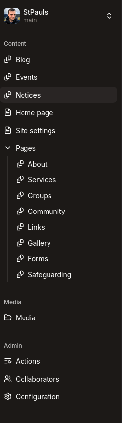

Ignore **Actions**, **Collaborators** and **Configuration** at the bottom if you see them. They are for Ste.

## 2. Adding a notice

1. Click **Notices**, then **Add an entry** at the top right.

   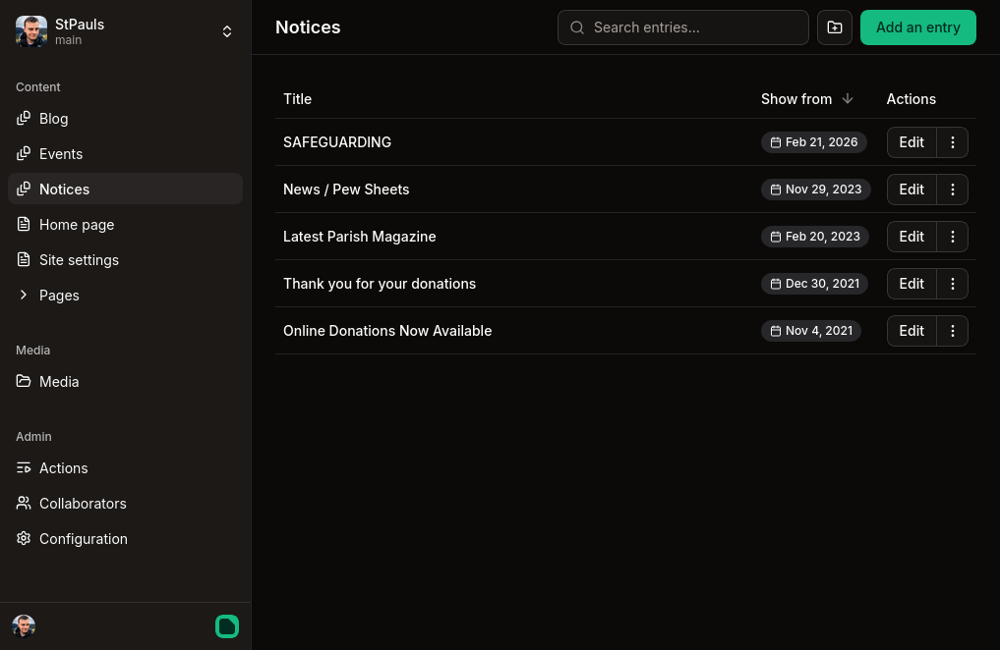
2. **Title**: the heading people see.
3. **Show from**: the day the notice starts showing on the home page.
4. **Show until**: the last day it shows. Leave it empty and the notice stays up until you take it down.
5. **Summary**: one or two sentences for the home page and the list of notices.
6. **Location** and **Topic** if they help. Both are optional.
7. **Notice**: the full text.
8. Click **Save** at the top right.

   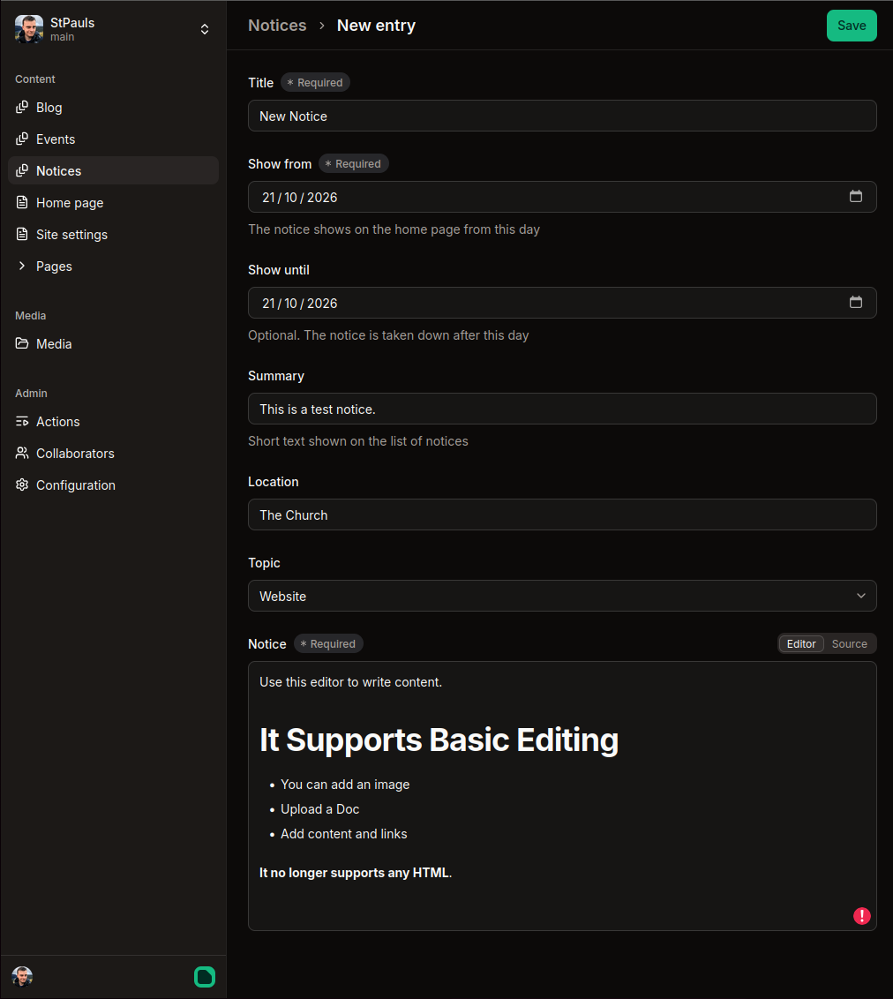

When it shows: a notice appears or goes away overnight, or the next time anyone saves anything. So a notice that starts tomorrow appears in the early hours of tomorrow. The home page shows the five newest notices that have started.

To take a notice down early, set **Show until** to yesterday and save, or delete it.

## 3. Adding an event

1. Click **Events**, then **Add an entry**.
2. **Title**.
3. **Starts**: the date and time it starts.
4. **Ends**: the date and time it ends.
5. **Summary**: a sentence or two for the calendar.
6. **Location**, a picture under **Image** with its **Image description** (see section 6), and a **Topic** if they help.
7. **Event details**: everything else people need to know.
8. Click **Save**.

The event shows on the calendar and on the home page under Upcoming Events. In the week before, it's marked **Soon**. While it's happening it says **Active** on the home page and **In Progress** on the calendar. Once it ends it drops off the calendar by itself, so there is nothing to tidy up.

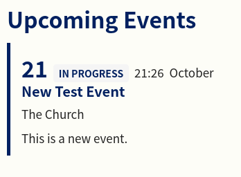

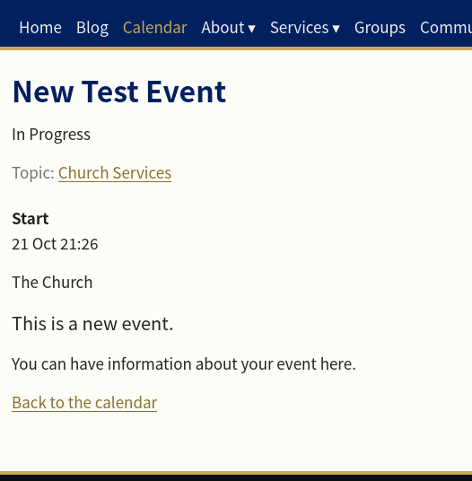

## 4. Writing a blog article

1. Click **Blog**, then **Add an entry**.

   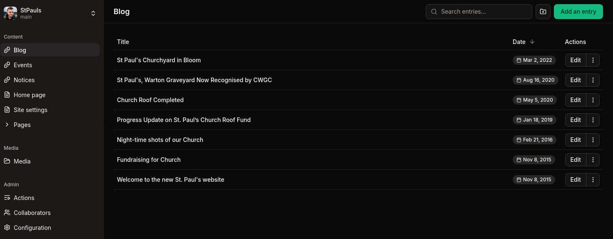
2. **Title** and **Date**.
3. **Author**: your name as you want it shown. It appears as "by Paul Barfoot" under the title.
4. **Summary**: a sentence or two shown on the blog list and at the top of the article.
5. **Image**: the main picture for the article. Without one, the website uses one of the church's own photos. Fill in **Image description** too (see section 6).
6. **Topic**: Website, Church Services, Church Events or Other Events.
7. **Article**: the text. To add a heading, a list or a picture, start a new line and type `/` to open a menu. To make words bold or a link, select them and use the bar that appears above them.

   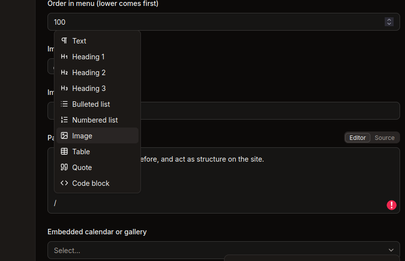
8. Click **Save**. A few minutes later the article is on the website.

   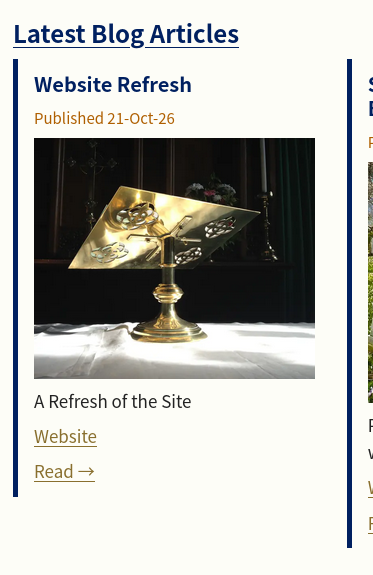

   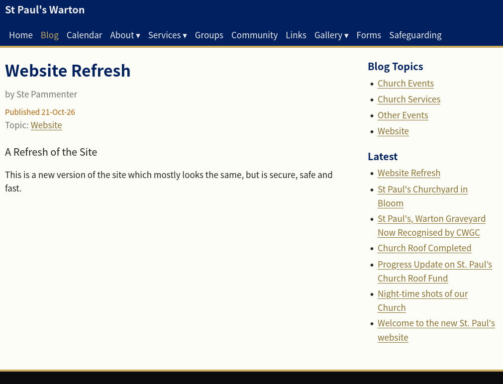

## 5. Changing a page

**Changing the words**

1. Click **Pages**, then the group it's in (for example **Services**), then the page.
2. Change the text under **Page**.
3. Click **Save**.

You can change a page's title without breaking anything. Its web address stays the same, so links people have saved still work.

**Adding a page to the top menu**

1. Click **Pages**, then the group it belongs in, then **Add an entry**.
2. Give it a **Title** and write the **Page**.
3. Switch on **Show in the top menu**. Switch on **Show in the footer** too if you want it at the bottom of every page.
4. **Order in menu**: lower numbers come first.
5. Click **Save**.

If a group has one page in the top menu, the menu links straight to it. With two or more, the menu item opens a short list.

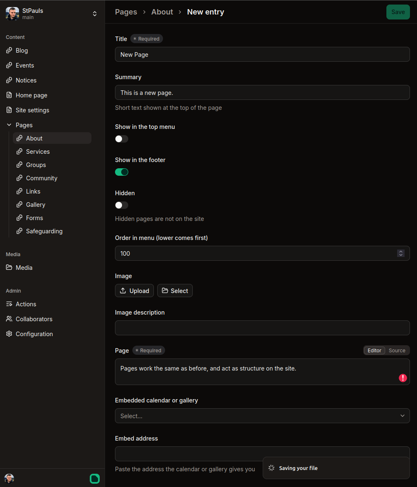

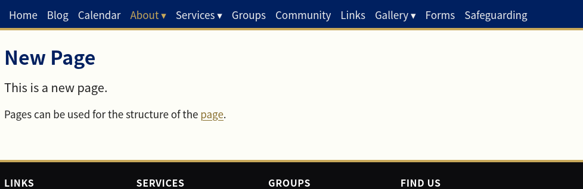

**Hiding a page**

1. Open the page and switch on **Hidden**.
2. Click **Save**. The page and its menu entry disappear at the next update.

Switch **Hidden** off and save to bring it back exactly as it was.

## 6. Adding a picture, a PDF or a Word document

**Uploading**

1. Click **Media**, then **Upload** at the top right, and choose the picture or document from your computer or phone. You can put it in one of the groups already there or leave it at the top.

   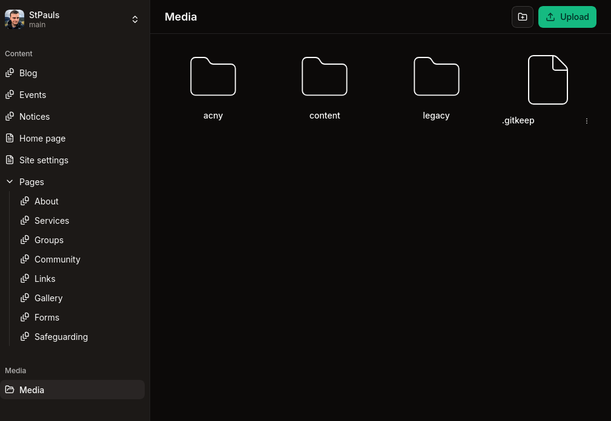
2. Its name is tidied up for you: spaces become dashes. You can upload pictures and documents such as PDFs and Word documents.

**Using a picture**

- Under **Image**, click **Select** to choose a picture from Media, or **Upload** to add a new one.

  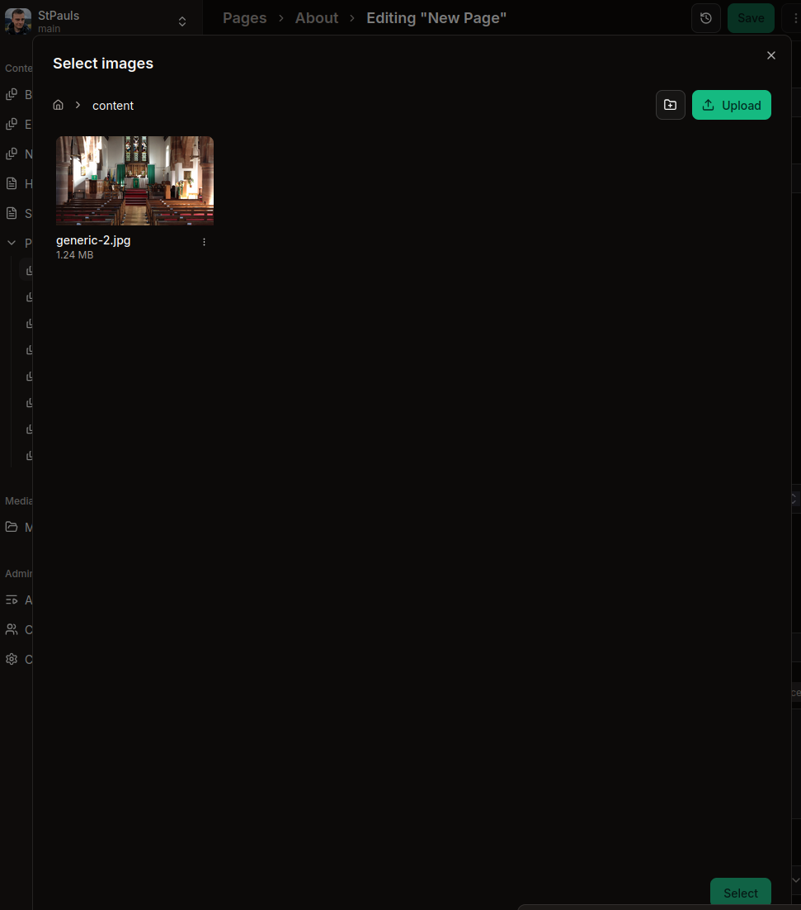
- In the middle of some text, start a new line, type `/` and choose **Image**, or drag the picture in.

**Describing a picture**

Every picture has a description box: **Image description** next to an Image box, or **Image alt text** when you click a picture in the middle of some text. Write one short sentence about what the picture shows, for people who can't see it, for example "The church in spring with crocuses in the churchyard". If the picture is only decoration, leave it empty.

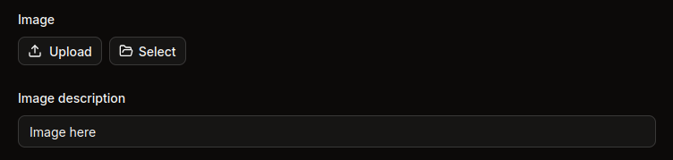

**Linking to a document**

1. Upload the document in **Media** and note its name as Media shows it, for example `baptism-form.pdf`.
2. In the page text, select the words you want people to click, such as "Baptism form".
3. In the bar that appears above them, click the link button (it looks like a chain) and type `/uploads/` followed by the name, for example `/uploads/baptism-form.pdf`. Click the tick.

   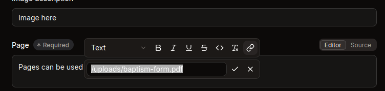
4. Click **Save**.

## 7. Changing the church diary or the gallery

The church diary is a Google calendar shown on the **Church Diary** page (under **Pages**, **About**). The gallery shows photos from the church Facebook page on the **Church Gallery** page (under **Pages**, **Gallery**).

1. Open the page.
2. **Embedded calendar or gallery** says which one the page shows. Leave it as it is.
3. **Embed address**: paste the new address.
   - For the calendar it starts `https://calendar.google.com/`. Google gives it to you in the calendar's settings, under "Integrate calendar". Copy only the web address, not the whole block of code.
   - For the gallery it starts `https://embedsocial.com/`.
4. Click **Save**.

Any other kind of address is ignored, and the page shows no calendar or gallery until it's put right.

On a new page, choose **Church diary** or **Photos from the church Facebook page** under **Embedded calendar or gallery**, then paste the address.

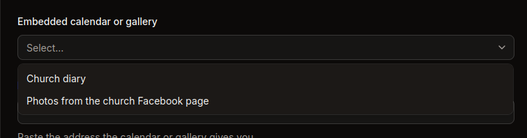

## 8. Changing contact details or the Facebook link

1. Click **Site settings**.

   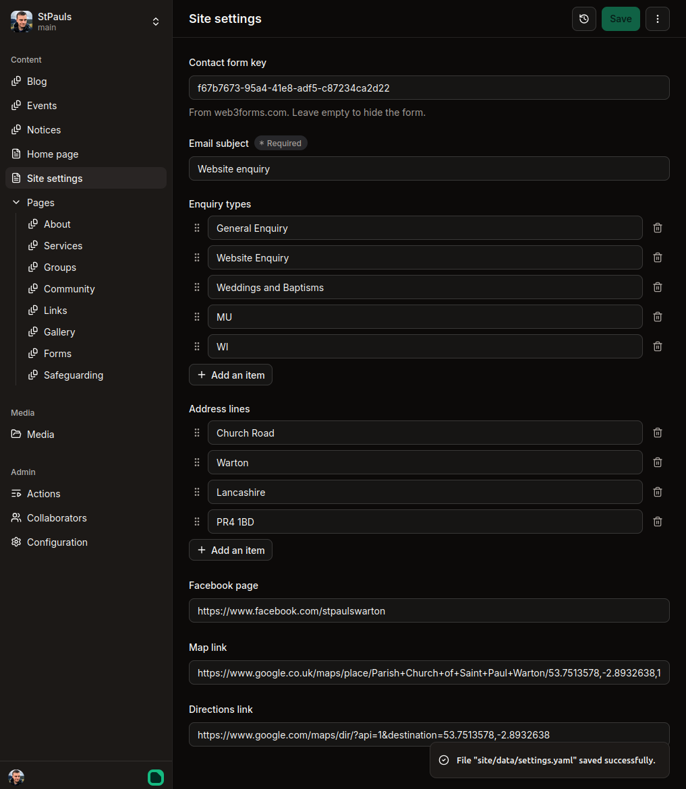
2. Change what you need:
   - **Address lines**: one line of the address in each box.
   - **Facebook page**: the address of the church's Facebook page.
   - **Map link** and **Directions link**: where the map and the address in the footer take people.
   - **Email subject** and **Enquiry types**: the subject line of enquiry emails and the choices on the contact form.
3. Click **Save**.

The footer and the contact page change at the next update. Leave **Contact form key** alone unless Ste asks you to change it. Emptying it hides the contact form.

## 9. What Save does

- **Save** puts your change on the website. A message at the bottom right says it saved, and the website shows it about three minutes later.

  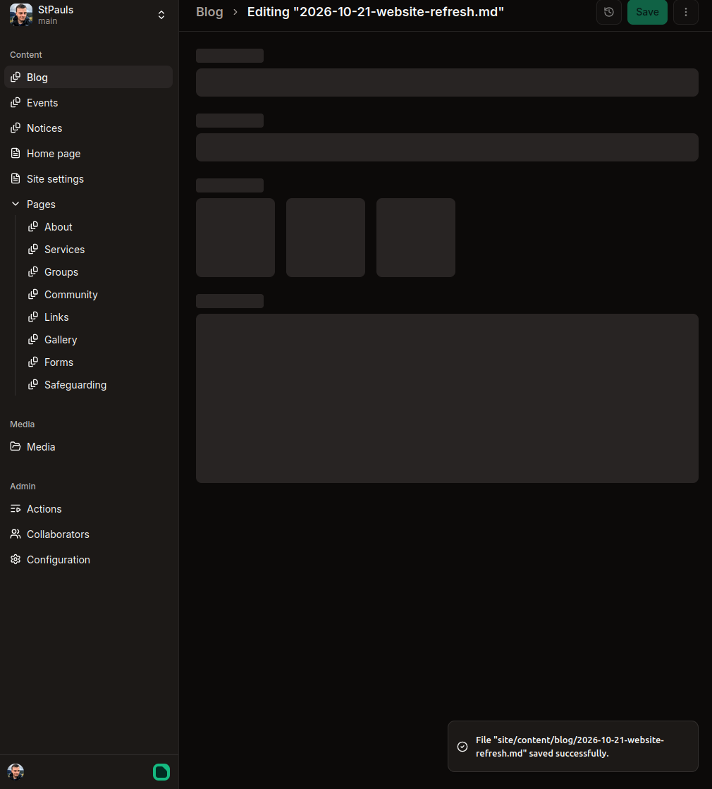
- There is no draft and no preview. Save, wait a few minutes, then look at the page on the website to check it.
- If something looks wrong, change it and save again.
- Notices that start or end on a date change overnight, as in section 2.

## 10. If something goes wrong

Every change is kept, so anything can be put back, even something you deleted. You can't break the website for good.

- If a page looks wrong after your change, put the old words back and save. If you can't remember them, ask Ste.
- If you delete something by mistake, even the Contact Us page or the only page in a group, the menus sort themselves out. Ask Ste and it can be put back exactly as it was.
- If something won't save, or you see a message you don't understand, take a screenshot and send it to Ste.

The home page and Site settings can't be deleted.

When you ask Ste, say what you changed and roughly when. That's all that's needed to find it.

## 11. During practice

Until switchover day, Pages CMS edits a test copy of the website. On the day, everything is copied across fresh from the old website, and anything added in practice is thrown away.

- Use made-up content, such as a notice called "Practice notice", and delete it when you're done.
- Keep making real changes on the old website until Ste tells you the switch is done.

## Practice checklist

Try each of these with made-up content on the test website, then delete what you added. Ste ticks them off and notes anything that was confusing.

| Done | Job | Section | Anything confusing |
|---|---|---|---|
| [ ] | Add a notice that shows from today until tomorrow | 2 | |
| [ ] | Add an event next week with a start and end time | 3 | |
| [ ] | Write a blog article with a picture, a description and your name as Author | 4 | |
| [ ] | Change a word on a page, add a practice page to the top menu, then hide it | 5 | |
| [ ] | Upload a picture and a PDF, and link to the PDF from a page | 6 | |
| [ ] | Open the Church Diary page and find the Embed address (change nothing) | 7 | |
| [ ] | Change the Facebook link in Site settings, check the footer, then change it back | 8 | |
